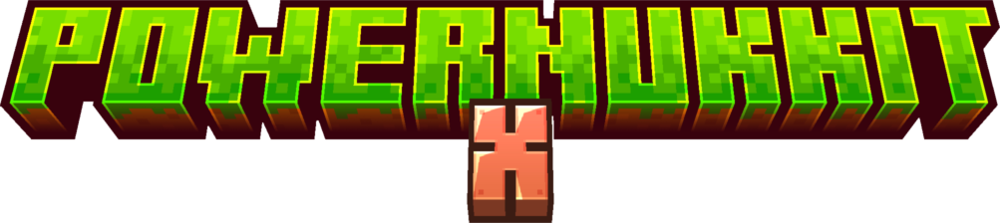

import { AppWindow, BookOpen, Code, Cpu, Download, LifeBuoy, MonitorSmartphone, Puzzle, Server, Shield, SlidersHorizontal, SquareTerminal, Users, Webhook, Zap } from "lucide-react";

**PowerNukkitX** (PNX) runs a Minecraft: Bedrock Edition server. It started from Nukkit and adds performance work, a richer plugin API, custom blocks, items and entities, and closer vanilla behaviour. It suits a private server for friends as well as a public network.

Players join with the regular Bedrock client, on any device, without mods. Everything the server needs lives in one folder:

<ServerArchitecture />

## Start here

<Cards>
  <Card icon={<Zap />} title="Quick start" href="/docs/quick-start">
    One command-line tool, four steps, a server you can join in about five minutes.
  </Card>
  <Card icon={<Download />} title="Install it your way" href="/docs/installation">
    Windows, macOS, Linux or Docker, with a plain jar and a start script.
  </Card>
</Cards>

## How these docs are organised

<Cards>
  <Card icon={<BookOpen />} title="Software" href="/docs/requirements">
    Requirements, installation, migration, configuration, permissions, plugins and integrations.
  </Card>
  <Card icon={<Server />} title="Administration" href="/docs/administration">
    Commands, players, worlds, performance and backups, day to day.
  </Card>
  <Card icon={<Code />} title="Development" href="/docs/development">
    A Java plugin from the first listener to custom blocks, items and forms.
  </Card>
  <Card icon={<LifeBuoy />} title="FAQ" href="/docs/faq">
    Short answers, fixes for common problems, and a glossary.
  </Card>
  <Card icon={<SquareTerminal />} title="PNX CLI" href="/docs/cli">
    Create, run and maintain a server from the terminal.
  </Card>
  <Card icon={<AppWindow />} title="PowerNukkitX app" href="/docs/assistant">
    The desktop app: a server without a terminal.
  </Card>
  <Card icon={<Webhook />} title="Web API" href="/docs/web-api">
    Read plugins, servers and badges from your own code.
  </Card>
</Cards>

## Why PowerNukkitX

<Cards>
  <Card icon={<Cpu />} title="Fast">
    Built for large worlds and many players, with low CPU and memory use under load.
  </Card>
  <Card icon={<Puzzle />} title="Extensible">
    A Java plugin API for commands, events, tasks, forms and custom content.
  </Card>
  <Card icon={<Shield />} title="Stable">
    Permission management, regular updates and a focus on long-running servers.
  </Card>
  <Card icon={<MonitorSmartphone />} title="Runs anywhere">
    Windows, Linux and macOS, and the latest Bedrock versions.
  </Card>
  <Card icon={<SlidersHorizontal />} title="Configurable">
    From server settings to gameplay rules, you decide how your server behaves.
  </Card>
  <Card icon={<Users />} title="Open source">
    Developed in public by an active community. Free under the LGPL-3.0 license.
  </Card>
</Cards>

## Supported platforms

PowerNukkitX runs on **Windows**, **Linux** and **macOS**, needs **Java 25 or newer**, and follows the latest Minecraft: Bedrock Edition releases. The [requirements](/docs/requirements) page has the hardware figures.

<Callout type="info" title="Get involved">
  PowerNukkitX is open source and community-driven. Report bugs or suggest features on [GitHub](https://github.com/PowerNukkitX/PowerNukkitX), or join the discussion on [Discord](https://discord.gg/powernukkitx).
</Callout>
