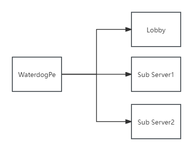

Um proxy deixa os jogadores circularem entre vários servidores (um lobby, sobrevivência, criativo...) sem desconectar. O PowerNukkitX suporta o [WaterdogPE](https://github.com/WaterdogPE/WaterdogPE), com encaminhamento de IP e transferência de sessão.

<ProxyNetwork />

## Configurar cada subservidor

<Steps>
  <Step>
    ### Pare o subservidor

    Edite o `pnx.yml` só com o servidor parado.
  </Step>
  <Step>
    ### Ative o modo proxy

    ```yaml title="pnx.yml"
    baseSettings:
      waterdogpe: true
      xboxAuth: false
    ```

    O proxy autentica os jogadores, então os subservidores não devem verificar o Xbox Live de novo: neles `xboxAuth` fica `false`.
  </Step>
  <Step>
    ### Registre-o no proxy

    No `config.yml` do WaterdogPE, adicione cada subservidor com endereço e porta UDP, e deixe o modo de encaminhamento de IP do proxy igual.
  </Step>
  <Step>
    ### Reinicie

    Reinicie cada subservidor para aplicar as configurações.
  </Step>
</Steps>



<Callout type="warn" title="Feche os inventários antes de uma transferência">
  Ao mover um jogador para outro servidor, por código ou por comando, feche antes os contêineres abertos dele (baús, formulários). Senão o inventário pode ficar dessincronizado no servidor de destino.
</Callout>
